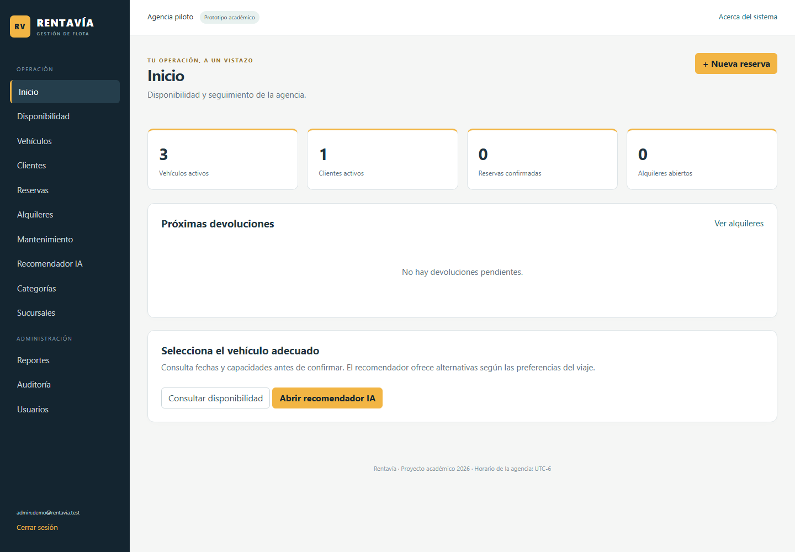

# Verificación funcional del prototipo

Revisión del 12 de octubre de 2026. Entorno local: .NET SDK 10.0.400, EF Core/Identity 10.0.11 y SQL Server Express `.\SQLEXPRESS`. Datos exclusivamente ficticios.

## Resultados obtenidos

- Solución y cinco proyectos, incluyendo pruebas: compilación correcta, cero errores y cero advertencias.
- Publicación Release de Rentavia.Web: correcta. La salida de comprobación está en `tmp/publish`, excluida de Git; la imagen Docker se construye de forma independiente.
- Migraciones `OperacionDeRentas` y `ReferenciaAuditoria` aplicadas después de `BaseInicialSqlServer`. No hay diferencias pendientes entre el modelo y las migraciones.
- Quince pruebas automatizadas correctas sobre reglas, adaptador HTTP simulado y SQL Server real. [Resultados JSON](Pruebas-automatizadas.json).
- Ochenta y siete comprobaciones del recorrido HTTP correctas. [Resultados JSON](Recorrido-web.json).
- Capturas de acceso, panel, disponibilidad, reservas, recomendador y móvil. Sin errores JavaScript ni desbordamiento horizontal. [Resultado visual](ui/resultado.json).
- Consulta del recomendador desde el navegador: formulario enviado correctamente y respaldo identificado en [captura de resultado](ui/07-recomendacion-respaldo.png).
- Enlaces locales de Markdown e imágenes: comprobados, sin enlaces rotos.
- Secretos de `.env`: ningún archivo versionado contiene las contraseñas locales o una clave API real. Cachés y temporales excluidos.

También se repitieron las restricciones del esquema: [resultado SQL](Pruebas-integridad-sql.txt).

Las pruebas SQL crean una base temporal con nombre único y la eliminan. Cubren reserva simultánea desde dos conexiones, tarifa histórica, modificación/cancelación, mantenimiento, entrega única, pago/saldo, devolución, liberación de ocupación, auditoría y rowversion. Una primera ejecución tuvo un error en la comprobación del nombre de limpieza; se corrigió, se eliminó su base temporal específica y la ejecución final terminó con cero fallos.

El recorrido HTTP comprueba todos los listados y formularios, crear/editar/eliminar los cuatro catálogos, placa duplicada, versión anterior, reserva → entrega → pago → devolución, rechazo de POST sin token, cuenta empleado y restricciones de administrador. Conserva operaciones/cuentas ficticias en la base de demostración; no se presenta como una base de agencia limpia.

## Evidencia visual

Se revisaron capturas de escritorio y móvil. Los valores del panel se consultan de la base, no se copian de los números ilustrativos de Fase I. Las fotografías de catálogo pueden cargarse; el catálogo demo muestra marcadores cuando no hay foto.

## Docker

`docker/Dockerfile`, Compose, variables, volúmenes y scripts de arranque están implementados. `docker compose --env-file .env -f docker/docker-compose.yml config --quiet` terminó correctamente.

**No hay evidencia de construcción ni ejecución Docker.** Docker Desktop falla antes de disponibilizar el motor Linux, con un error interno al abrir/renombrar `sailor-ingest.sock`. El arranque y reinicio normales no resolvieron el problema. La revisión automática rechazó la limpieza de archivos internos por política; no se ejecutó dicha limpieza ni un restablecimiento de fábrica.

Cuando el entorno se recupere, ejecutar `scripts/Iniciar-docker.ps1`, recorrer la aplicación, reiniciar servicios conservando volúmenes y registrar resultado. Una validación de configuración no demuestra contenerización funcional.

## OpenAI y pendientes externos

El adaptador real de Responses está implementado. Las pruebas usan transporte simulado para validar solicitud, salida y rechazos; la web muestra respaldo explícito si no hay clave. **No se realizó una llamada OpenAI real**, porque no está configurado el acceso API. No se presenta la simulación o el respaldo como IA acreditada.

Quedan pendientes video de 5-10 minutos y participación de los cinco integrantes, publicación/colaboración real en el repositorio del equipo, Investigación Aplicada II y validación con usuarios. La asistencia, test y coevaluación corresponden al proceso académico; no pueden acreditarse mediante código.

El repositorio local conserva commits con autoría Codex para el prototipo, Docker/pruebas y documentación. No se atribuyen esos commits a integrantes del equipo y no se publicaron a un remoto.

El estado por criterio está en [Matriz de cumplimiento](../fase-2/Matriz-de-cumplimiento.md). Los manuales describen implementación y limitaciones actuales, sin afirmar un despliegue Azure ni Docker probado.
