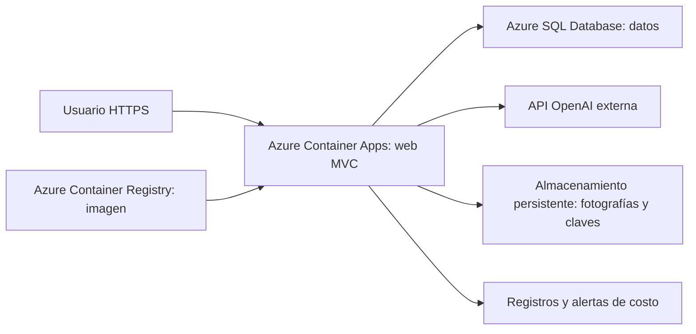

# Propuesta documental de despliegue en Azure

**Azure no se utilizará ni se desplegará en este proyecto.** Esta alternativa se documenta para cumplir la guía de Fase II. La demostración real es local/Docker y el servicio de IA confirmado es la API de OpenAI, no Azure OpenAI.

## Arquitectura hipotética

Container Apps ejecutaría la imagen de la aplicación con plan Consumption, ingreso HTTPS y escalado a cero cuando esté inactiva. Azure SQL Database mantendría el modelo relacional compatible con el proveedor SQL Server. Container Registry conservaría la imagen versionada. Almacenamiento persistente reemplazaría volúmenes locales para fotos y claves de sesión. Migraciones se aplicarían mediante una tarea administrativa controlada, antes de publicar una revisión.

La operación necesitaría identidad/secretos, conexión de datos con certificado válido, permisos mínimos, registros y pruebas de restauración. No se añadiría SQL Server Developer como base de producción en la misma aplicación.

Beneficios previstos: reutilización de la imagen Docker, despliegue versionado, administración del motor de datos y escalado según demanda. Son beneficios de la alternativa, no resultados comprobados de Rentavía en Azure.

## Estimación académica mensual

Escenario hipotético en East US, USD, treinta días: una réplica web de 0.5 vCPU/1 GiB activa una hora diaria, menos de 50,000 solicitudes, una base pequeña y pocos archivos. Sin crédito estudiantil, impuestos ni contrato comercial. Consulta de referencias: 12 de octubre de 2026.

| Componente | Estimación USD/mes | Fundamento |
| --- | --- | --- |
| Web Container Apps | 0.00 de cómputo/solicitudes bajo este supuesto | 54,000 vCPU-segundos y 108,000 GiB-segundos: dentro de las asignaciones gratuitas si no están consumidas por otros recursos |
| Base Azure SQL pequeña | Reserva presupuestaria 5.00-15.00 | Estimación académica para evaluar un nivel básico; no es una cotización de precio verificada |
| Container Registry Basic | Aproximadamente 5.00 | Tarifa pública consultada por API Retail: 0.1666 USD/día × 30; excluye almacenamiento adicional y tareas |
| Fotografías, registros y tráfico | Reserva presupuestaria 3.00-10.00 | Depende de volumen, retención, región y transferencia; supuesto de baja demanda |
| Total hipotético Azure | 13.00-30.00 | Suma de referencias y reservas presupuestarias; no habrá gasto Azure real en este proyecto |

Azure publica una asignación mensual compartida de 180,000 vCPU-segundos, 360,000 GiB-segundos y dos millones de solicitudes para Consumption. No garantiza costo total cero: otros servicios/uso pueden generar cargos. Fuente: [facturación Container Apps](https://learn.microsoft.com/en-us/azure/container-apps/billing).

La [página de precios Azure SQL](https://azure.microsoft.com/en-us/pricing/details/azure-sql-database/single/) muestra niveles DTU y configuración Basic de 5 DTU/2 GB; su tarifa dinámica no pudo confirmarse en la consulta, por eso se usa una reserva presupuestaria explícita. El dato Registry se obtuvo de la [API pública de precios de Microsoft](https://prices.azure.com/api/retail/prices) filtrando Container Registry, East US y Basic. Antes de cualquier adopción futura, sustituir las reservas por una cotización de la [calculadora Azure](https://azure.microsoft.com/en-us/pricing/calculator/) con fecha, región y uso concreto.

## Consumo OpenAI por separado

La API de OpenAI se presupuestará para la demostración real, independientemente de Azure. La referencia publicada para `gpt-4.1-mini` es USD 0.40 por millón de tokens de entrada y USD 1.60 por millón de salida. [Fuente oficial del modelo](https://developers.openai.com/api/docs/models/gpt-4.1-mini).

Como ejemplo de cálculo, cien consultas de 2,000 tokens de entrada y 300 de salida representan aproximadamente USD 0.128: 200,000/1,000,000 × 0.40 + 30,000/1,000,000 × 1.60. El número de tokens es un supuesto, no consumo medido ni saldo mínimo requerido. Configurar límites de cuenta y observar consumo real. La aplicación limita frecuencia, candidatos y salida, pero esos límites no sustituyen controles de presupuesto de la cuenta.

No se crearon cuentas ni recursos Azure. La llamada OpenAI real sigue pendiente de acceso API; la integración y el respaldo están implementados.
