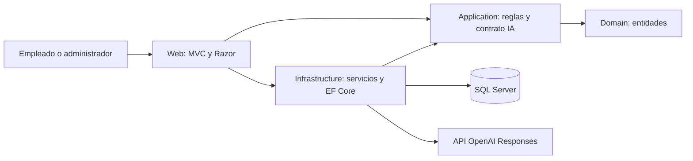

# Manual técnico de Rentavía

## Arquitectura y tecnologías

Monolito modular en cuatro proyectos .NET 10: Domain contiene entidades, Application contiene reglas puras y el contrato del recomendador, Infrastructure contiene EF Core y servicios que escriben datos o consumen OpenAI, Web contiene MVC/Razor, formularios y autenticación.

Dependencias: Application → Domain, Infrastructure → Application, Web → Application e Infrastructure. No hay repositorios genéricos, mediadores, CQRS ni microservicios. Los CRUD simples usan el contexto desde su controlador; los cambios que afectan varias tablas usan AgendaService y AlquilerService.

SDK 10.0.400; EF Core SQL Server, Identity y herramienta EF 10.0.11. Bootstrap y jQuery de la base existente se sirven localmente. JavaScript propio solo pide confirmación de operaciones; las reglas están en el servidor. El CSS está separado y la interfaz adapta menú, tablas/formularios y tarjetas a móvil.

## Estructura y módulos

| Carpeta | Responsabilidad |
| --- | --- |
| `src/Rentavia.Domain/Entities` | Catálogos, reserva, agenda, alquiler, pago, mantenimiento, auditoría y recomendación |
| `src/Rentavia.Application/Services` | Días, totales, intervalos y conflicto de versión |
| `src/Rentavia.Application/Recommendations` | DTO e interfaz del servicio externo |
| `src/Rentavia.Infrastructure/Data` | Contexto, configuración, migraciones y carga administrativa explícita |
| `src/Rentavia.Infrastructure/Services` | AgendaService, AlquilerService y OpenAiRecomendador |
| `src/Rentavia.Web/Controllers` | Acceso, usuarios, cuatro CRUD, disponibilidad, reservas, alquileres, mantenimiento, recomendación y reportes |
| `src/Rentavia.Web/Models` | Formularios limitados y modelos de presentación |
| `src/Rentavia.Web/Views` | Vistas Razor de los módulos |
| `database/scripts` | Esquema generado y comprobaciones SQL |
| `docker` | Dockerfile y Compose |
| `scripts` | Arranque y preparación explícita |
| `tests` | Reglas/SQL/adaptador, recorrido HTTP y capturas visuales |

## Persistencia y consistencia

El [modelo implementado](../tecnico/Modelo-completo.md) describe las entidades y relaciones. La migración inicial se conserva y `OperacionDeRentas` amplía el esquema. Dinero usa decimal(12,2), horarios datetimeoffset en UTC y licencia date. La presentación convierte a UTC-6. Vehículo, cliente, reserva y alquiler usan rowversion.

La disponibilidad usa intervalos `[inicio, fin)`: períodos adyacentes no se cruzan. Ocupaciones reúne reservas/alquileres y mantenimiento. Una fila se relaciona con reserva o mantenimiento, nunca con ambos. La entrega reutiliza la ocupación; cancelación, devolución o finalización del servicio la liberan.

Cada operación de agenda bloquea el vehículo con `UPDLOCK, HOLDLOCK` dentro de una transacción serializable. Consulta cruces y guarda todo antes de confirmar. Así, dos empleados no validan simultáneamente el mismo vehículo como libre. No sustituir este mecanismo por una consulta fuera de la transacción.

El índice filtrado permite como máximo un alquiler abierto por vehículo. Las FK restringen borrados históricos, hay índices únicos de placa/documento y comprobaciones de capacidades, km, combustible, fechas e importes. Reserva guarda tarifa/días/estimado; editar el catálogo no modifica lo acordado.

Entrega y devolución conservan inspección inicial/final en el alquiler: km, combustible y observaciones. El prototipo registra un cargo agregado con concepto y pagos parciales; no hay una pasarela ni cálculo automático de daños/retrasos. No se requiere saldo cero para devolver; el saldo queda en el detalle.

## Seguridad y manejo de errores

Identity administra hashes y cuentas internas. No hay registro público. Login usa cookies HttpOnly/SameSite y bloqueo por intentos. Los módulos exigen Administrador o Empleado; gestión de cuentas, eliminación y reportes requieren Administrador. Los formularios reciben modelos específicos, no entidades completas. Todas las escrituras web validan antifalsificación, ModelState y reglas del servidor.

Cuenta bloqueada cambia su security stamp; la validación de sesión ocurre cada minuto. Login tiene límite de veinte intentos por minuto/IP y recomendación diez consultas por minuto/usuario. El recomendador maneja timeout de treinta segundos.

Las operaciones sensibles guardan auditoría en la misma transacción que sus cambios. La auditoría no contiene contraseñas, claves ni documentos. La página general de error muestra una referencia y no revela el SQL. Los errores de negocio y concurrencia regresan mensajes comprensibles al formulario.

Las fotografías tienen máximo 2 MB, admiten firmas PNG/JPEG y reciben nombre aleatorio, sin usar el nombre suministrado. Se almacenan en `wwwroot/uploads/vehiculos`. Son archivos públicos del catálogo; no deben contener documentos personales. Se limpian cargas nuevas si falla el guardado; fotografías antiguas sustituidas requieren limpieza operativa posterior.

## OpenAI

OpenAiRecomendador implementa IRecomendador con HttpClient. Hace POST a `/v1/responses`, autentica con Bearer, usa `gpt-4.1-mini` configurable, solicita esquema JSON estricto y `store=false`. Se envían preferencias del viaje y hasta veinte candidatos filtrados. No se envían datos del cliente.

El servidor exige entre una y tres sugerencias, IDs distintos pertenecientes a la lista y motivos no vacíos de hasta quinientos caracteres. Respuestas incompletas/defectuosas, HTTP fallido, timeout o ausencia de clave producen respaldo por tarifa, identificado como **Reglas (sin IA)**. La recomendación no modifica una reserva.

Se conserva solicitud anonimizada, candidatos, resultado, origen, modelo y versión de prompt `rentavia-v1` para trazabilidad. Las preferencias son texto del usuario: no incluir datos personales. La API key se obtiene solo del entorno/configuración externa. Referencias: [Responses](https://developers.openai.com/api/reference/resources/responses/methods/create), [salida estructurada](https://developers.openai.com/api/docs/guides/structured-outputs?api-mode=responses), [modelo](https://developers.openai.com/api/docs/models/gpt-4.1-mini).

Las pruebas del adaptador usan respuestas simuladas y verifican contrato y rechazos; no equivalen a una llamada real. La prueba real queda pendiente de una clave API disponible.

## Configuración y Docker

Development usa SQL Server Windows. Docker usa otro SQL Server mediante DNS `database`, autenticación SQL y variables externas. No reutiliza `.\SQLEXPRESS` dentro de Linux.

La imagen compila/publica por etapas con SDK y runtime .NET 10, ejecuta usuario `app` y escucha 8080. Compose añade SQL Server 2025 Developer, healthcheck, volúmenes de datos/fotos/claves y servicio `setup` para comandos explícitos `--migrate`, `--create-admin`, `--seed-demo`. No hay migración implícita del servidor web.

`Seguridad__RedirigirHttps=false` solo se usa en la demostración Docker sobre loopback. Publicación real requiere TLS, certificado de datos válido, credenciales con permisos mínimos y gestión de secretos. Las claves DataProtection persisten en `/app/keys`, fuera de la imagen.

La configuración Compose fue validada; construcción y ejecución siguen pendientes por fallo del motor Docker de esta máquina. La [instalación](Instalacion.md) contiene comandos; la [propuesta Azure](../fase-2/Propuesta-Azure.md) es exclusivamente documental.

## Pruebas y mantenimiento

El ejecutable C# de pruebas evita dependencias adicionales de un framework de testing. `dotnet run --project tests/Rentavia.Tests -- --sql` ejecuta reglas, adaptador simulado e integración con SQL Server real. Su base temporal tiene prefijo reservado y GUID; la elimina al cerrar. `RENTAVIA_TEST_CONNECTION` permite indicar otra instancia y `RENTAVIA_TEST_RESULT` guarda resultados JSON.

`tests/web_recorrido.py` requiere requests/beautifulsoup4 y una base de demostración ya preparada. Lee la cuenta local de `.env`, crea datos ficticios, prueba CRUD y flujo HTTP y deja alquileres/cuentas de prueba. No ejecutarlo sobre una instalación con datos de agencia. `tests/ui-capturas.cjs` usa Playwright para capturas y comprobación de errores/desbordamiento; es opcional y no es dependencia de la aplicación.

Antes de agregar una migración, compilar y verificar `dotnet ef migrations has-pending-model-changes`. Revisar el SQL, aplicar explícitamente y volver a probar agenda. No reescribir migraciones ya aplicadas.

Los resultados están en [Verificación funcional](../evidencias/Verificacion-funcional.md). Quedan pendientes respaldos/restauración operativa, validación con usuarios reales, llamadas OpenAI reales y ejecución Docker. Las pruebas actuales no acreditan un despliegue de producción.
