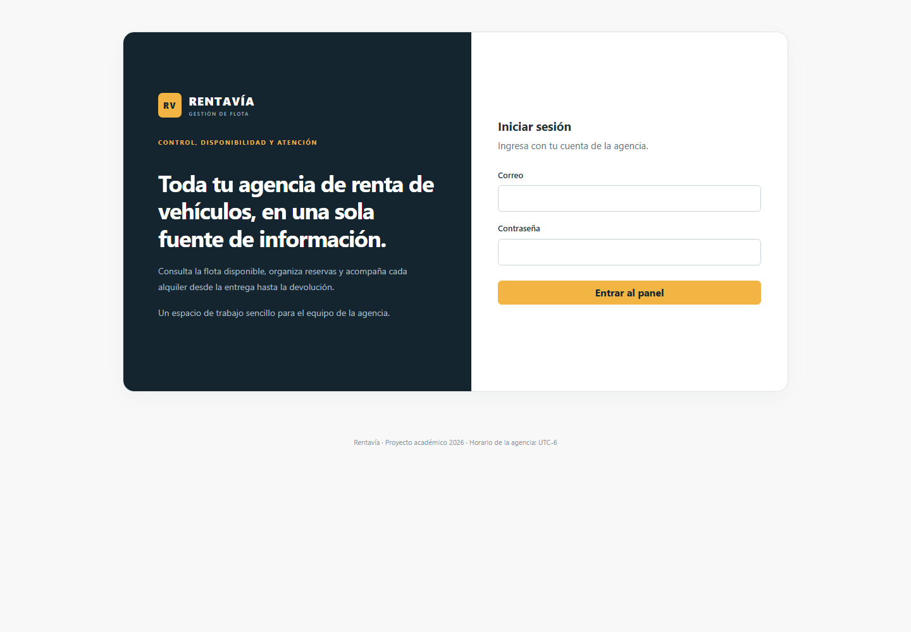
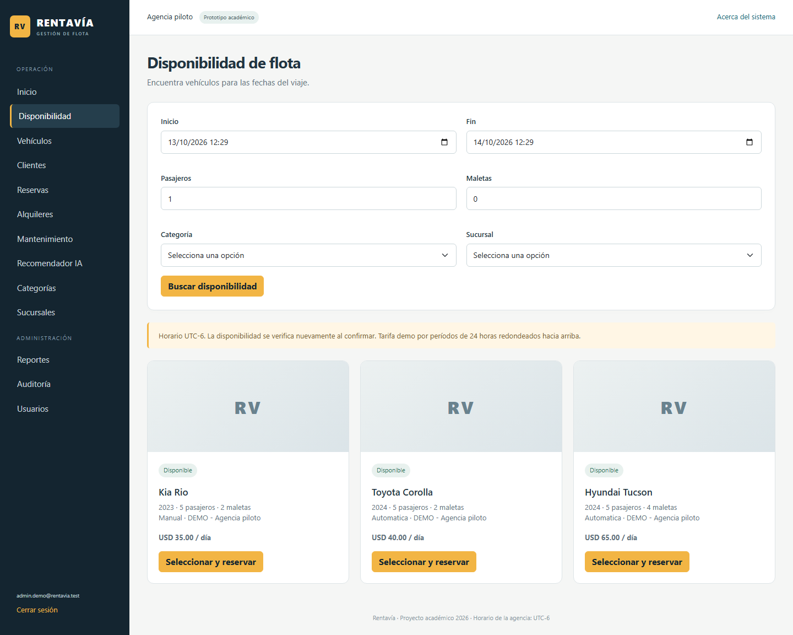

# Manual de usuario de Rentavía

Rentavía organiza la operación interna de una agencia piloto. Los clientes son registros; no tienen portal público. El administrador administra usuarios, catálogos, reportes y auditoría. El empleado gestiona clientes, flota y operaciones de renta. Ambos trabajan sobre la misma disponibilidad.

## Acceder y navegar

Abrir la dirección indicada por el responsable de instalación e ingresar correo y contraseña. Si se producen cinco intentos incorrectos, la cuenta se bloquea temporalmente diez minutos. El menú contiene Inicio, Disponibilidad, Vehículos, Clientes, Reservas, Alquileres, Mantenimiento, Recomendador IA, Categorías y Sucursales. El administrador también ve Usuarios, Reportes y Auditoría.

Inicio muestra cifras obtenidas de la base y próximas devoluciones. **Cerrar sesión** termina el acceso. Una sección restringida muestra un mensaje de falta de permisos.

## Preparar los catálogos

El administrador crea categorías y sucursales. Una sucursal inactiva no ofrece vehículos para nuevas reservas. Desde Vehículos, usar Nuevo vehículo para registrar placa, marca, modelo, año, categoría, sucursal, pasajeros, maletas, kilometraje, transmisión, estado y tarifa diaria.

Las placas se normalizan y no se duplican. El kilometraje no puede disminuir. La fotografía admite PNG o JPEG de hasta 2 MB. La tarifa positiva y el estado Activo son necesarios para ofrecer el vehículo. Cambiar la tarifa no altera reservas anteriores.

Desde Clientes registrar nombre, apellido, tipo/número de documento, licencia, vencimiento, teléfono y correo opcional. Los documentos no se duplican para el mismo tipo. Un cliente inactivo o sin licencia vigente durante el período no puede reservar.

Editar guarda correcciones. Eliminar está disponible para administrador: un cliente o vehículo sin historial puede borrarse; si tiene historial, se desactiva o retira. Categorías y sucursales referenciadas no se eliminan. Si aparece un conflicto de edición, recargar antes de guardar nuevamente.

## Consultar disponibilidad y reservar

1. Abrir Disponibilidad y elegir inicio, fin, pasajeros, maletas y filtros opcionales de categoría/sucursal.
2. Buscar y comparar vehículos. Las opciones excluyen ocupaciones por reserva, alquiler o mantenimiento.
3. Seleccionar y reservar; elegir el cliente y confirmar fechas.
4. Guardar. El servidor vuelve a comprobar el intervalo y puede rechazarlo si otro empleado lo ocupó.

El prototipo usa horario UTC-6, moneda USD y períodos de 24 horas redondeados hacia arriba. No aplica tolerancia, depósito, margen de limpieza ni penalización automática. Los parámetros son de demostración y necesitan validación para operación real.

Desde Reservas se consultan estado, fechas y total acordado. Editar permite cambiar cliente y fechas conservando el vehículo y la tarifa histórica. Para cambiar de vehículo, cancelar y crear otra reserva. Cancelar libera la agenda y conserva el registro. Una reserva convertida o cancelada no se vuelve a editar.

## Entregar, devolver y registrar pagos

Desde una reserva confirmada, pulsar Entregar. Se permite desde cinco minutos antes del inicio y mientras el período siga vigente. Registrar kilometraje, combustible en porcentaje y observaciones de inspección. La entrega crea un alquiler y reutiliza la agenda de la reserva.

En Alquileres, Detalle presenta cliente, vehículo, período, tarifa histórica, inspecciones, total, pagos y saldo. Imprimir genera una vista para papel del registro académico; no implica un contrato legal validado.

Registrar pago guarda monto positivo, método y referencia opcional. No permite superar el saldo. Es un registro interno; no realiza cobro bancario ni usa pasarela.

Registrar devolución solicita kilometraje final no menor al anterior, combustible, observaciones y cargo adicional opcional. Un cargo positivo requiere concepto. Confirmar cierra el alquiler, actualiza kilometraje y libera la agenda. El total es el estimado histórico más el cargo registrado; puede quedar un saldo pendiente que sigue visible y puede pagarse.

Un alquiler atrasado se destaca y excluye el vehículo de nuevas operaciones. Revisar reservas posteriores y coordinar con los clientes antes de entregar otro alquiler. La aplicación no mueve reservas automáticamente.

## Programar mantenimiento

Elegir vehículo, tipo preventivo/correctivo, fechas, descripción y costo. La operación rechaza períodos ocupados. Primero resolver las reservas existentes si hay conflicto. Finalizar el servicio libera su ocupación; el registro permanece para el historial y reportes.

## Usar el recomendador

Indicar fechas, pasajeros, maletas, presupuesto diario y preferencias del viaje, sin datos personales. El sistema filtra hasta veinte candidatos elegibles y el servicio OpenAI propone hasta tres alternativas con una explicación.

La pantalla muestra el origen del resultado. **OpenAI** identifica una respuesta del servicio; **Reglas (sin IA)** identifica el respaldo cuando falta configuración o ocurre un fallo. Una sugerencia no reserva: elegir vehículo abre el formulario normal y la disponibilidad se valida nuevamente al confirmar.

## Reportes y usuarios

El administrador consulta un rango de hasta un año. Reportes muestra pagos registrados, reservas creadas, entregas, costo de mantenimiento y utilización observada por vehículo. La utilización mide horas reales entre entrega y devolución dentro del período; alquileres abiertos se cuentan hasta la consulta. Los denominadores usan la flota registrada actual, no un inventario histórico reconstruido.

Auditoría muestra las últimas doscientas operaciones con actor, acción, entidad y fecha; no guarda contraseñas. Usuarios permite crear cuentas de Administrador o Empleado y bloquear/desbloquearlas. Una cuenta no puede bloquearse a sí misma. Tras cambiar acceso, una sesión existente se invalida en la siguiente comprobación de seguridad, aproximadamente en un minuto.

## Mensajes habituales

- Conflicto de agenda: seleccionar otro vehículo/período o resolver la ocupación existente.
- Otro usuario modificó el registro: recargar y revisar la versión actual.
- Datos duplicados/referenciados: corregir el formulario o desactivar en lugar de eliminar.
- Falta de permisos: solicitar la operación a un administrador.
- Error general: intentar nuevamente e informar la referencia mostrada si persiste.

Las capturas corresponden a datos ficticios del prototipo local. La llamada OpenAI real y el recorrido Docker siguen pendientes de evidencia; consultar el [estado de evaluación](../fase-2/Matriz-de-cumplimiento.md).
