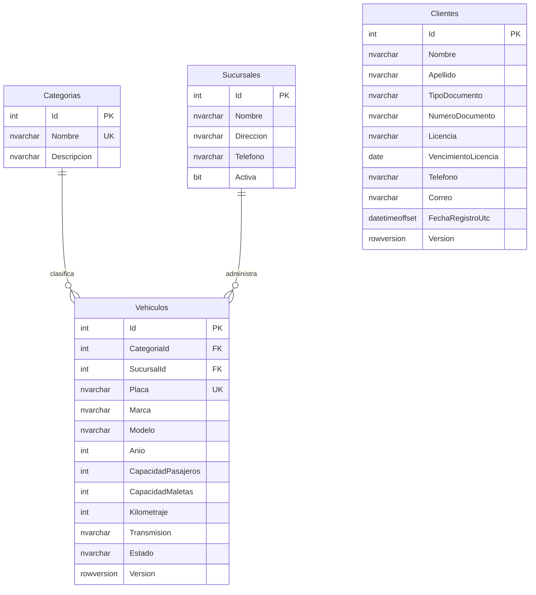

# Modelo inicial de datos de Rentavía

Corresponde a RentaviaDbContext y la primera migración de SQL Server. Aún no incluye reservas, alquileres, tarifas ni pagos. El estado del vehículo no representa disponibilidad por fechas.

## Diccionario

Todos los Id son int IDENTITY, PK y obligatorios. Campos obligatorios salvo indicación de opcional.

| Tabla | Campo | Tipo SQL Server | Regla |
| --- | --- | --- | --- |
| Categorias | Nombre | nvarchar(50) | Único |
| Categorias | Descripcion | nvarchar(150) | Opcional |
| Sucursales | Nombre | nvarchar(100) | Nombre operativo |
| Sucursales | Direccion | nvarchar(200) | Ubicación |
| Sucursales | Telefono | nvarchar(20) | Opcional |
| Sucursales | Activa | bit | Estado operativo |
| Vehiculos | CategoriaId | int | FK Categorias, borrado restringido |
| Vehiculos | SucursalId | int | FK Sucursales, borrado restringido |
| Vehiculos | Placa | nvarchar(15) | Única; normalización pendiente del formulario |
| Vehiculos | Marca, Modelo | nvarchar(50) cada uno | Identificación |
| Vehiculos | Anio | int | Rango pendiente del formulario |
| Vehiculos | CapacidadPasajeros | int | Mayor que cero |
| Vehiculos | CapacidadMaletas | int | Mayor o igual que cero |
| Vehiculos | Kilometraje | int | Kilómetros enteros, no negativo |
| Vehiculos | Transmision | nvarchar(20) | Manual o Automatica |
| Vehiculos | Estado | nvarchar(20) | Activo, FueraDeServicio o Retirado |
| Vehiculos | Version | rowversion | Generada por SQL Server |
| Clientes | Nombre, Apellido | nvarchar(50) cada uno | Nombre de persona |
| Clientes | TipoDocumento | nvarchar(20) | Parte del índice único compuesto |
| Clientes | NumeroDocumento | nvarchar(30) | Único junto con TipoDocumento |
| Clientes | Licencia | nvarchar(30) | Número de licencia |
| Clientes | VencimientoLicencia | date | Fecha sin hora |
| Clientes | Telefono | nvarchar(20) | Contacto |
| Clientes | Correo | nvarchar(100) | Opcional |
| Clientes | FechaRegistroUtc | datetimeoffset(0) | Asignar UTC al crear cliente |
| Clientes | Version | rowversion | Generada por SQL Server |

rowversion detecta ediciones concurrentes; no es una fecha. Longitud y nulabilidad no sustituyen validación de campos vacíos, correo, licencia y normalización en formularios.

## Identity

Tablas AspNetUsers, AspNetRoles, AspNetUserRoles, AspNetUserClaims, AspNetRoleClaims, AspNetUserLogins y AspNetUserTokens. Identity administra el hash de contraseñas; no se añade una columna propia. Aún no hay cuentas ni relación usuario-sucursal.

## Extensiones pendientes

Horarios previstos/reales, ocupaciones compartidas con mantenimiento, tarifa histórica, inspecciones, cargos/pagos, auditoría y detalle de recomendaciones. El ER y diccionario se actualizarán con cada migración. No se presentan estas entidades pendientes como implementadas.
